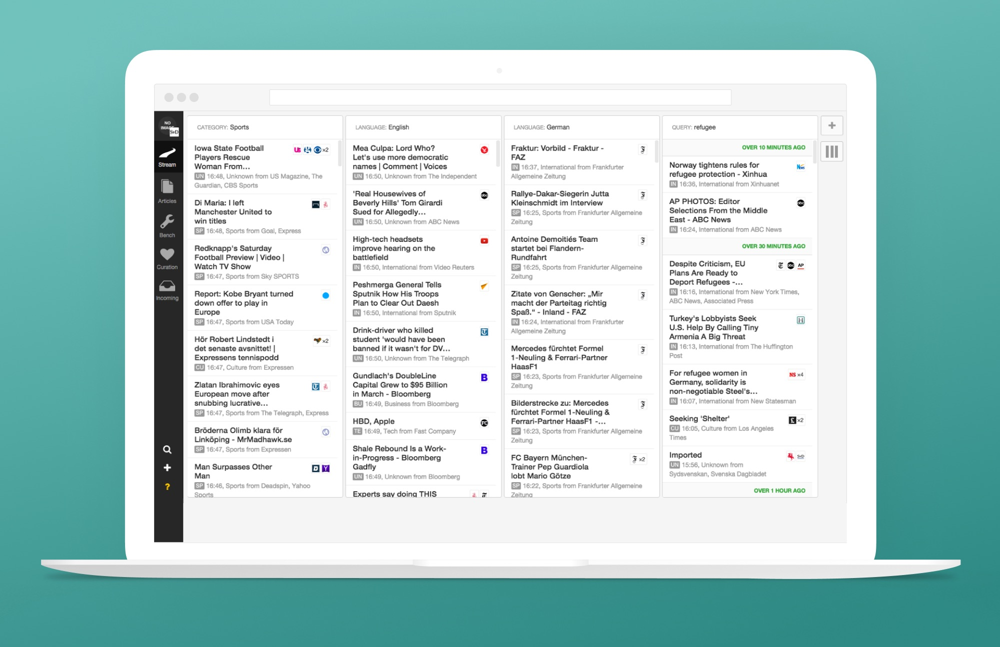

    

The Discover tool is a part of an award-winning set of tools that gives professional newsroom users the functionality they need to publish newspapers in the digital age. Discover is used to find, read and monitor news from a variety of sources.

News articles are collected from websites, mobile apps and social media are pushed into customizable "lanes" on the user's screen. The lanes can be filtered and set up for topics and sources that are currently relevant to the user.
 

## Key Challenges

Some key challenges developing the tool were:

- How do we handle and prioritize a high amount of news coming in on a constant basis?
- Understanding the needs of news editors and journalist while driving the shift from print news to a true digital news provider
- Unifying five toolbox products that were developed separately by their own teams and UX designers to feature a common look & feel








## Design Process

This was a long-running and ever changing project. So the process was less linear and adapted.

-  A huge part of the development work in terms of UX were **user interviews**. We relied a lot on qualitative feedback from our users that were in-house. They were contacted and met on a regular basis to talk about the general state of the app, their perception of new feature, how their workflow is changing or can be improved and so on.
- **Wireframes and mockups** were created as a means of communication and discussion with pen+paper, Axure RP Pro or Sketch.
- **Framer or InVision prototypes** were created to present ideas to users and gather feedback.
- Most ideas were discussed with between product and UX first via in-person meetings or VCs and then discussed further in GitHub issues.
- Sometimes we held **design workshops or design sprints** with the whole team to gather ideas and create a common understanding of the problem.
- Asking questions in interview is sometimes limiting because users need to be very conscious about their own behavior. Sometimes we used exercises like a collaborative **workflow mapping and card sorting**. This challenged users to question their priorities.
- **Quantitative analytics tools** gave us insights into the most used features and informed the prioritization of the roadmap.

Here are some example of prototypes that I have made to test ideas for interactions, animations and so on:








## Project Takeaways

- Users are quick to ask for specific changes but it is always good idea to ask more questions and figure out the real need behind it. Often more elegant solutions are possible to more fundamental problems.
- Adding features may add value but it also adds cost for complexity and learnability.
- Don't be afraid to question if you are really solving the right problem after testing an MVP and pivot. We had features that were solving a certain problem but during testing revealed that the new understanding of the problem suggests other solutions that work better.
