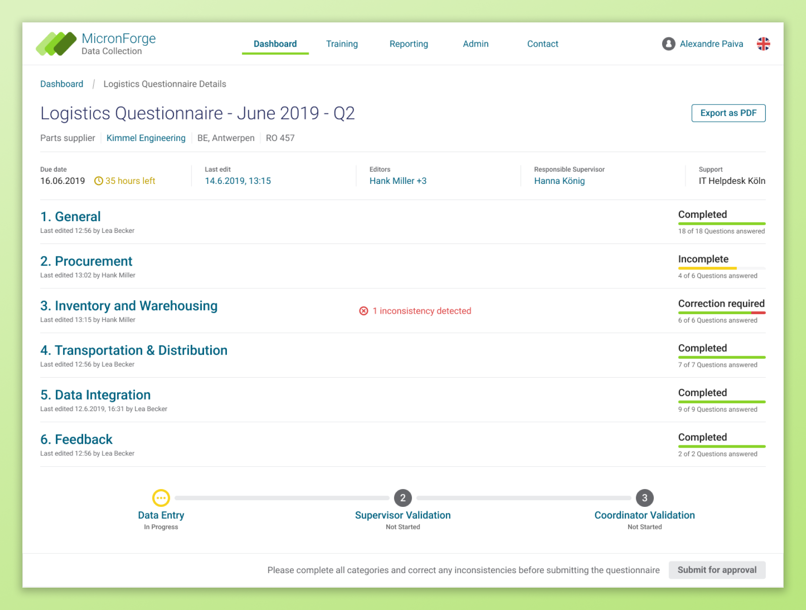

    

The client had a web application to fill out surveys by departments all over the world. The application also provided ways to audit data in a multi-stage approval process. The interface was very outdated and tedious to handle.

The brief from the client said that they wanted to have a modern redesign of their application without any major changes of the structure. After some convincing, the client agreed to have a user research phase that helped us understand the usage patterns and pain points.

In the end the application was not just redesigned with a modern style and the company's corporate identity. Instead, the interface was also adapted to drop unnecessary complexity, clearly display survey progress and provide a more straightforward entry point to the currently relevant survey. This benefits the many users that only use the system one to three times per year.

The interface was changed for the presentation in this portfolio to not show client information and processes.








## Design Process

- Kickoff workshops with the client
- Interviews with five users in different locations
- Sorting through results and discussing findings with stakeholders
- Wireframes to discuss UI and workflow changes with stakeholders
- User testing with click prototypes based on wireframes
- HiFi Mockups delivered with Zeplin and click prototypes for the developers
- Animations and interactions built as guide for developers with [Drama](https://www.drama.app)








## UX learnings
- In the old app the users had to set very specific filters to find the surveys they needed to fill out. Working with sorting and account-specific parameters yielded the most relevant surveys to the user for most use cases without any filtering and all other surveys with very few filter interactions.
- Reviews were handled outside the system by email or phone. Integrating this into the system made it a lot easier to keep track of states for user who fill out surveys as well as reviewers.
- The responsibility for different part of surveys is split in departments. Parallel data entry is therefore better supported via state visualization and display of the change history.

## Project Takeaways

Web applications for professionals are often accepted to be complex and less user friendly. The common attempt to solve this is to provide training for users. However, a lot of complexity can be hidden or processes can be better guided by the interface, which reduces the need for training.

When client stakeholders don't have experience with projects that include a user experience component, it is difficult for them to anticipate what UX design can do for the project. In this case it was obvious that a designer would help to create a more appealing interface. However, the stakeholders did not expect to change the workflow or interface beyond visual aspects like typography, colors etc. When they heard about the potential to increase satisfaction, reduce friction, reduce demand for support and training, as well as reduce user mistakes they were motivated to adapt.