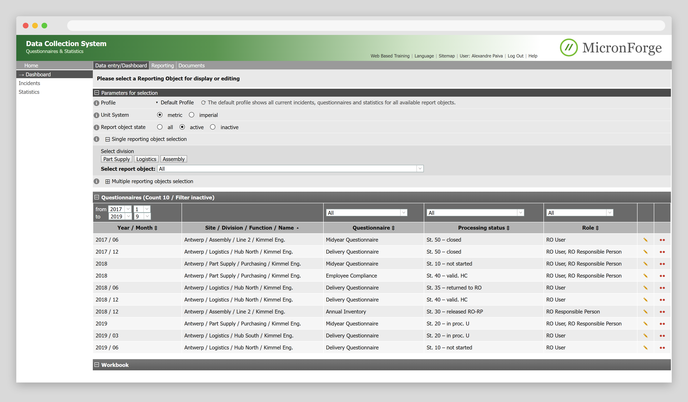
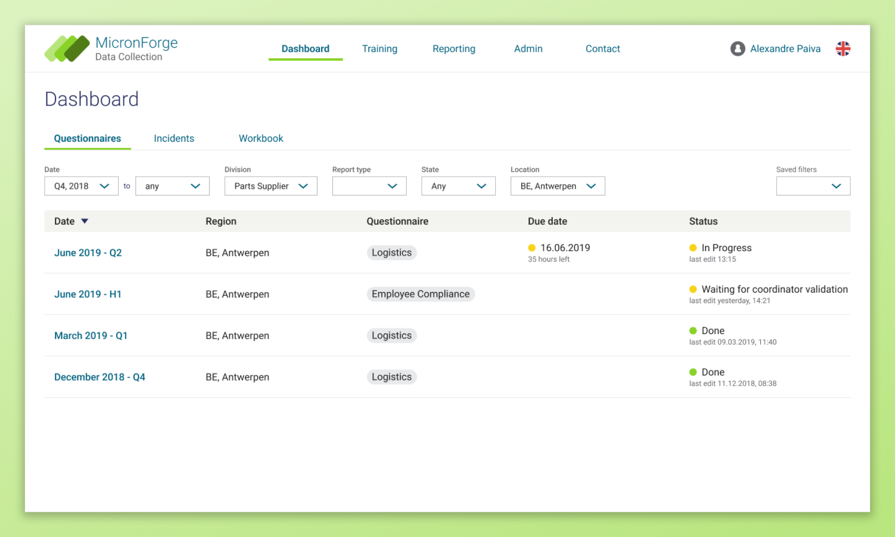
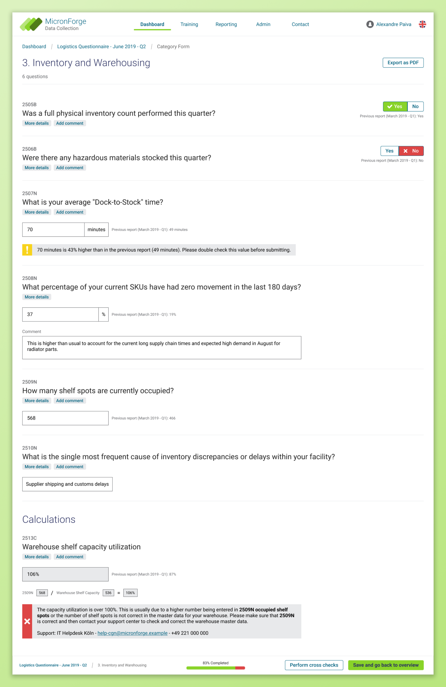

The client asked for a modern UI for a 20-year-old in-house application that collects figures from departments across a large enterprise, with the structure left as it was. A central team checks every submission, and the figures go into the company's reporting.

I convinced the client to start with user interviews. They showed that the friction was in the workflow, not in the look.

## What the interviews showed

- **Finding the right questionnaire took too long.** The application was slow, and people needed several filter steps on every visit before they saw their own questionnaire.
- **Questionnaires are not filled in by one person in one sitting.** People enter a few values, go and find the rest, and come back days later. Different parts come from different colleagues. The old application only saved a complete and valid questionnaire, so unfinished entries could get lost.
- **Reviews happened outside the application.** When the central team found a problem, they wrote an email or called.
- **Comment fields were too small** for the explanations people had to give.

With two to six questionnaires a year, nobody learns the application. Every visit starts from scratch, so the application has to remember the context for its users. Three decisions came out of that.

## 1. Your current questionnaire first, without setting a filter

The old dashboard showed everything the account could see. To get to their own questionnaire, people picked a division, a report object and a period, and waited for the page to reload after each step.

<figure class="annotated images border">
    

        
        1
        2
        3
    

    <ol class="legend">
        <li>Division and report object have to be picked by hand, although the account belongs to one department.</li>
        <li>The timeframe has to be set with month and year dropdowns, which takes several clicks.</li>
        <li>Status is written in internal codes and is hard to scan for open tasks.</li>
    </ol>
</figure>

The account already knows which department and location a person belongs to. The new dashboard uses that and sorts by date, newest first. The current questionnaire and the last few are on top without a single filter. The filters are still there for anyone who needs another location or an older year.

<figure class="annotated images border">
    

        
        1
        2
        3
        4
    

    <ol class="legend">
        <li>Division and location come from the account. They can be changed, but rarely need to be.</li>
        <li>To find older reports, the timeframe is set in quarters. That takes far fewer clicks and matches the survey cadence: yearly, half-yearly or quarterly.</li>
        <li>Newest first, so the questionnaire that is due now is the first row.</li>
        <li>Status says in plain words what happens next, for example that the questionnaire waits for the coordinator.</li>
    </ol>
</figure>

## 2. Fill in over several days, with several people

A questionnaire is a collection job. Someone fills in what they know, asks a colleague for the rest and comes back later. The redesign supports that instead of expecting one complete session.

    

        
Before

        <ul>
            <li>Saving only works when everything is complete and valid</li>
            <li>Users started collecting data outside of the tool as a workaround</li>
            <li>No overview of what is still missing</li>
            <li>No trace of who contributed what</li>
        </ul>
    

    

        
After

        <ul>
            <li>Every value is saved after it is entered. Come back any time and continue where you left off.</li>
            <li>Work with multiple users on the same report.</li>
            <li>Completion per category, and a list of what to fix before submitting</li>
            <li>Each category shows who edited it last</li>
        </ul>
    

## 3. Reviews in the application instead of in inboxes

Two people in the central team checked every submission. When a number looked wrong, they wrote an email or called, and the department corrected and submitted again. The department did not know whether its questionnaire had been accepted, and the central team kept track of open questions in their own mail.

In the redesign, inconsistencies are flagged on the category they belong to while people fill in, so many problems are fixed before the central team sees them. Supervisor and coordinator validate in the application, and everyone sees the same status.

The questionnaire overview brings decisions 2 and 3 together.

<figure class="annotated images border">
    

        
        1
        2
        3
        4
        5
    

    <ol class="legend">
        <li>Each category shows how many questions are answered, so anyone coming back sees what is left.</li>
        <li>All editors and the responsible supervisor are listed, and each category shows who edited it last. Who to ask about a number is on the page.</li>
        <li>An inconsistency is flagged on its category before the central team has to find it.</li>
        <li>The three validation steps are visible to the department, not only to the reviewers.</li>
        <li>Submitting is possible once all categories are complete, and the page says what is still missing.</li>
    </ol>
</figure>

## What we kept

The old application already showed last period's answer next to each field, warned when a value looked implausible and showed which inputs a calculated value came from. That catches mistakes before the central team has to, so all of it stayed. What changed is room to explain: comment fields became large text areas.

    <figure>
        
        <figcaption>A category with previous values, a plausibility warning, a large comment field and a calculated value.</figcaption>
    </figure>

## How I worked

After kickoff workshops with the client I interviewed five users at different locations and sorted the findings in an affinity diagram with the team. I mapped the review process with the stakeholders. Wireframes and click prototypes went to the central team for review, because they check every questionnaire and chase every correction. The final designs went to the developers as Sketch mockups in Zeplin and as InVision prototypes.







## What I take from it

- **The application has to remember, because its users don't.** For a tool people open a few times a year, the account, the last questionnaire and every value already typed in are the best help there is.
- **Hand over a system, not just screens.** Design and development ran one after the other, and by the time the screens were built I was on another project. During development, sizes and spacing drifted from the per-screen specs in Zeplin, and there was no designer left to review the result. Readability and user satisfaction suffered. Today I hand over components and tokens and review the build before release, as on [DaziT](/portfolio/2022-03-01-customs-toolchain-framework.html).
- **A few interviews can change a brief.** The client asked for a new look. Five interviews were enough to show how much a redesign could improve efficiency and user satisfaction. That convinced the client to aim higher.
