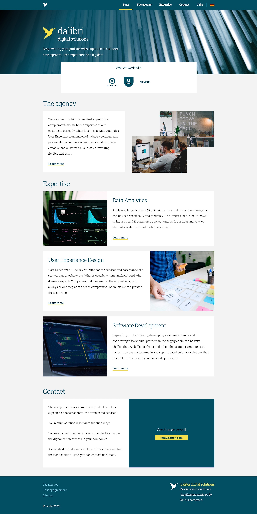

    

In 2020, dalibri's website was still one that has been put together in two evenings. It was clear that potential new clients that looked us up should get a better first impression. The goal was to have a professional but friendly presentation that shows what services dalibri provides at a quick glance and a more detailed level.

## Process

- Collecting and sorting the outline and content in a workshop
- Creating a wireframe for the start page
- Developing text with a content writer in interviews and iterations
- Exploring design direction
- Deciding on design direction and iteration close to final design
- Implementing the responsive website with support for two languages

## Design & Tech Stack

- Designs and wireframes were done in Figma
- The website was built with HTML, CSS (SASS) and Jekyll as a static site generator
- The code was checked into a bitbucket repository and deployed with a bitbucket pipeline script





