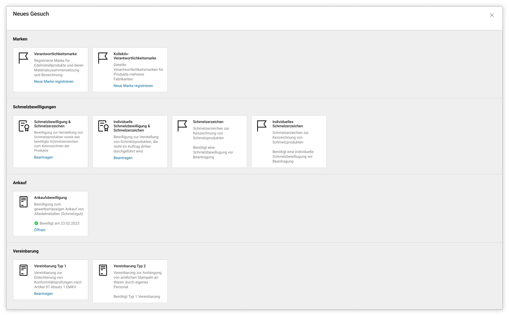
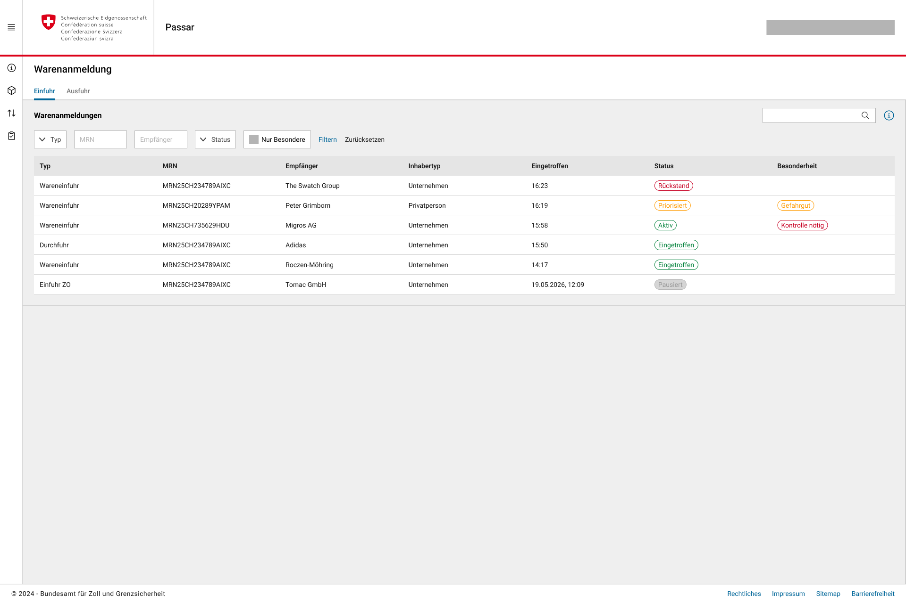
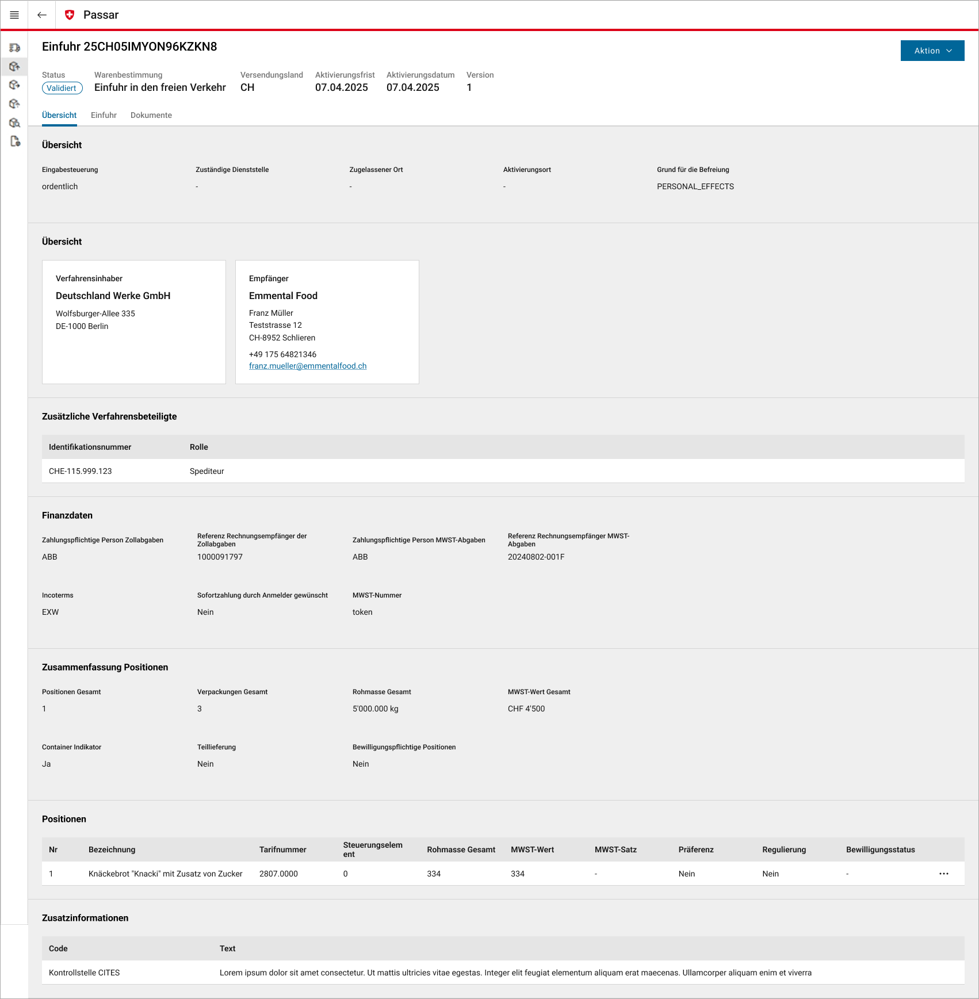
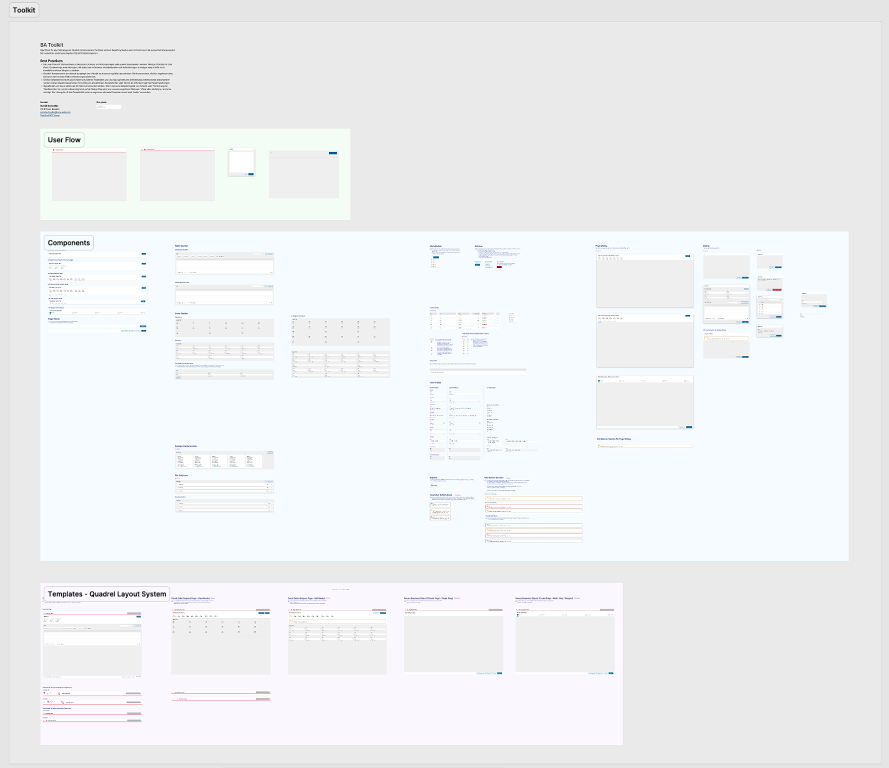
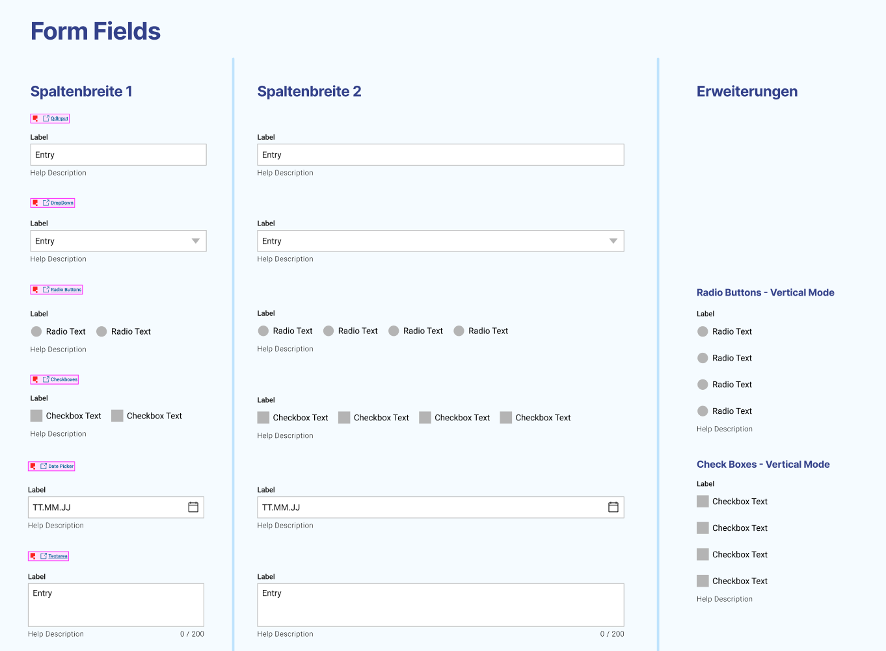

[DaziT](https://www.bazg.admin.ch/bazg/en/home/topics/dazit.html) is the digital transformation programme of the Swiss customs authority. Paper forms and legacy software are replaced by around 40 applications, from goods declaration to precious metals control. All of them are assembled from one low-code UI framework, [Quadrel](https://www.bazg.admin.ch/bazg/de/home/themen/dazit/vereinfachung-und-digitalisierung/entwicklerplattform.html), so that they behave the same and the teams write little frontend code of their own.

I was a UX designer in the framework team. I planned user flows with the application teams and designed the framework components those flows needed. Three decisions from that work are described below.

<dl class="facts">
    
<dt>programme budget</dt><dd>CHF 393 m</dd>

    
<dt>applications I worked on</dt><dd>15</dd>

    
<dt>UX designers for ~40 applications</dt><dd>1 - 3</dd>

</dl>

## 1. One screen instead of a hunt for the right form

Businesses that work with precious metals need marks and permits from the control office. To request one, they had to know which request applied to them, find the matching PDF form on the website and fill it in. Nothing showed them what they already held, because none of it was digital.

    

        
Before

        <ol>
            <li>Work out which mark or permit applies</li>
            <li>Find the matching PDF form on the website</li>
            <li>Submit form with complete client information every time</li>
            <li>Receive permits on paper</li>
        </ol>
    

    

        
After

        <ol>
            <li>See available permits and their purpose</li>
            <li>Requirements are checked against your account</li>
            <li>Request a new permit, client information is managed in the account</li>
            <li>Held permits are attached to the account</li>
        </ol>
    

Our earlier draft was a wizard that began with picking a form. That works for someone who already knows which form they need. We put this overview in front of the wizard as a step zero, and it answers the questions in the order people have them.

<figure class="annotated images border">
    

        
        1
        2
        3
        4
    

    <ol class="legend">
        <li>Each of the nine request types says in one sentence what it is for. They are sorted into four groups, so the choice starts with the area and not with a form number.</li>
        <li>A type the account does not qualify for stays visible and names what is missing. A melter's mark, for example, requires a melting permit first.</li>
        <li>A type the account qualifies for starts its request right here. The client details come from the account and are not entered again.</li>
        <li>A permit the account already holds shows its approval date and opens directly, so nobody requests it twice.</li>
    </ol>
</figure>

## 2. Lists that work before anyone touches a filter

Application teams often asked for two things: a date-range filter for their lists, and one large screen that shows everything at once, with live previews and drag and drop. Both were hard to build from framework components. Both also skipped a simpler question: what is the user trying to find?

    

        
Asked for

        <ul>
            <li>A date-range filter to narrow the list</li>
            <li>One screen with every data point of every object</li>
            <li>Live preview and drag and drop between areas</li>
        </ul>
    

    

        
Built instead

        <ul>
            <li>A default sort order: newest first, combined with priority</li>
            <li>An overview with only the fields needed to pick the right object</li>
            <li>A detail page that opens once the object is chosen</li>
        </ul>
    

With that sort order the recent and important cases sit at the top, and one category filter is usually enough to reach the rest. The overview carries only what it takes to pick an object. Everything else moves to the detail page, where it concerns one object and no longer clutters every row.

What we gave up were the rich single-screen interactions. In return the screens kept a clear hierarchy and clear rules for when data is saved, and lists behave the same in every application.

    <figure>
        
        <figcaption>Overview: seven columns, enough to pick an entry.</figcaption>
    </figure>
    <figure>
        
        <figcaption>Detail: one goods declaration, with all its data in standard components.</figcaption>
    </figure>

## 3. A kit that lets teams draft their own screens

Business analysts and product owners in the application teams drafted screens to show their ideas, in PowerPoint, Miro or wireframing tools. Many of those drafts could not be built. Quadrel components fix layout, sizes and colours and only allow configuration. With one to three UX designers for around 40 applications and many engineering teams, we could not redraw every draft either.

On my own initiative I built a FigJam board that holds most of our components. Analysts copy components onto the whiteboard, change texts and variants, and compose a screen. FigJam has no layer tree, no auto layout and no component configuration, so there is little to learn, and it is hard to draw something the framework cannot do.

The kit cannot do fine layout. A first draft for a discussion with stakeholders does not need it.

About five teams used the kit. Their first drafts were made of standard components, which put them closer to what could be built, and the teams no longer had to wait for a UX designer to get started.

    <figure>
        
        <figcaption>The board: instructions, components and page templates.</figcaption>
    </figure>
    <figure>
        
        <figcaption>Form fields, ready to copy and relabel.</figcaption>
    </figure>



## How I worked

For each application I worked out the requirements with business analysts and users, mapped the flow, and collected what the framework could not do yet. Those gaps went to the framework team as component proposals with specifications and user stories. Prototypes went back to analysts and users for review and usability tests.








## What I take from it

- Most requests arrive as a solution: a filter, a preview, a drag and drop. The work is to find the question behind it, and the answer is often simpler than the request.

- Consistent adoption across more than 10 teams and 40 applications stayed hard to the end. Stakeholders all have ideas and expectations. It requires continuous tech evangelizing work. What helped most was explaining why a standard exists and finding a workable answer inside it.
