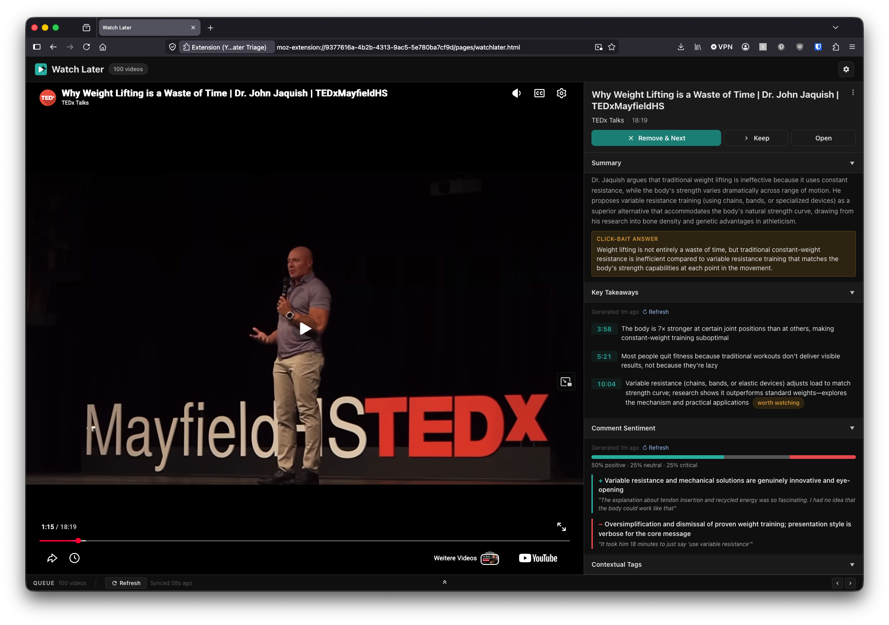
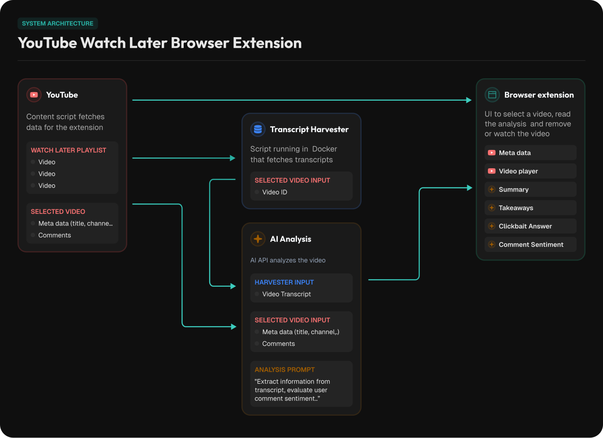

YT Watch Later Triage is a Firefox extension I designed and built solo. It lets the user go through their YouTube Watch Later list and see condensed information from the video transcript and comments. The displayed information is often sufficient to understand the core messages of the video, or at least to make a quick decision whether it is worth the viewing time.

This is a design-engineering piece, focusing on the prototype–iterate–release workflow with Claude Code, AI as a product feature and a design system. I did not apply the UX analysis and testing I would use for bigger and more serious projects.

You can try it as a [demo page](https://davidslr.github.io/yt-watch-later-triage/demo/) with pre-generated content.

The code and installation instructions can be found on [GitHub](https://github.com/DavidSlr/yt-watch-later-triage/).

    

## Overview

This is a Firefox extension that primarily serves one web application page built from UI components. It uses a workaround to extract transcripts from YouTube videos, then combines the video metadata, transcript and comments with an analysis prompt and sends it to an LLM API. Analyzing about 130 videos through Claude Haiku cost roughly $0.70.

The application consists of:
- Firefox browser extension
- Extension UI made of web components ([Storybook](https://davidslr.github.io/yt-watch-later-triage/) with WCAG audit)
- A Docker service to fetch transcripts
- Support for Claude Haiku and Gemini
- Three GitHub workflows signing the extension releases, registering the Docker container with GHCR.io and building the Storybook / demo pages

    

## AI Prompts for Analysis

The extension asks the AI endpoint to analyze the video by assembling a [prompt](https://github.com/DavidSlr/yt-watch-later-triage/blob/master/pages/prompts.js) as a mix of instructions and specific video data. This yields several quick-digest insights about the video content.

The **click-bait answer** recognizes a teaser title and tries to find its answer in the video content. It works very well when the AI has access to the transcript. This alone was so surprisingly useful that the extension went from a quick proof-of-concept prototype to actually being useful to me and getting daily use.

The **key takeaways** display an overview of the points made in the video and provide a way to jump to specific sections. I experimented a bit with different lengths of text and added a way to distinguish between videos that develop a single topic and list-style videos. In case of a list ("8 ways to do X"), each item becomes its own takeaway.

The **comment sentiment** is analyzed for how it feels about the video. When I initially asked the AI to rate the comments as positive or negative, it rated the tone of each individual comment. That flagged comments as negative when they were angry about the topic but actually agreed with the video, and as positive when they joked around while disagreeing with it. I had to make it clear that the comments should be rated according to how they relate to the video's message. It is not perfect but gives a lot better insight into the reception of the video.



## Project Setbacks

Good analysis needs transcripts, and YouTube does not hand those out to automated clients. This became the hardest part of the build by a wide margin. About a third of my prompts to Claude Code across the whole project went into this one subsystem.

I tried several approaches. Web service calls were always detected despite my efforts to make them look like real user behavior. A background browser tab that loads each video worked but defeated the whole purpose of this extension. Prototyping was really useful here to get a feel for what is feasible.

In the end I landed on a small local service in a Docker container that pulls public transcripts. This works well but requires a rather complex setup that isn't really feasible for the majority of potential users.

The solution isn't optimal, but Claude Code enabled me to try out a broad range of approaches and feel them out. It also let me do a lot of reverse-engineering work that I would not have been able to do manually in a reasonable time.

## Building it as a Design System

Halfway through, the project stopped being only a tool and became the thing I wanted to show. I rebuilt the UI as a proper system: 14 Lit web components, 69 tokens, and a Storybook.

Claude was very helpful for discussing technology decisions like the component framework. I wanted to keep it simple as this isn't a big project. [Lit](https://lit.dev/) builds the web components: simpler component code, clean use in Storybook, and a bundle the GitHub workflow compiles for the browser. It also made the static demo page trivial to build.

I pushed the components to Figma over MCP to see whether a code-to-design-to-code round trip could be a productive workflow. Variables and tokens synced reliably. Component structure did not: sizes and spacing were ignored, wrong colors were used and so on. AI can draft components, in code or in Figma, that look right and quietly use the wrong values. I abandoned the idea of doing design tweaks in Figma, as the deterministic sync that would be needed isn't there (yet). Code stays the source of truth. Figma is useful for experimenting with styles that then get turned into code with a proper review.

Once I shifted to components I could work on accessibility improvements. The WCAG audit is documented in Storybook. Claude is helpful with auditing and especially with fixing issues. There were still failures found by testing rather than by the audit, like keyboard control issues.



## AI Development

AI tools like Claude Code enable anybody to build digital prototypes and products quickly. As a product designer, I now have new options to test ideas and contribute to products in a development team. I learned to appreciate my computer science background and experience more through AI development. It allows me to understand and question the plans that AI proposes, find edge cases to test applications, and directly refer to structures in code, CSS classes, flex layouts and so on, which makes formulating change requests much more effective and targeted.

## Project Takeaways

- Claude Code is a powerful tool for prototyping, component development and other tasks like reviews and audits. Results should still be checked on a regular basis, which might also feed back into Claude for more thorough work afterwards. I am excited to integrate more AI capabilities into my workflows.

- Currently I find it rather difficult to seamlessly switch between Figma and code. They can still live side by side and be used for certain tasks they excel at, like style explorations that can be done quickly in Figma.

- AI product features are super powerful. People are still trying to figure out what AI can do, and chatbots way too often become the hammer that makes everything look like a nail. But users still need guidance and structure in their work. Traditional UIs can pair very well with AI functionality without making everything free-text based.